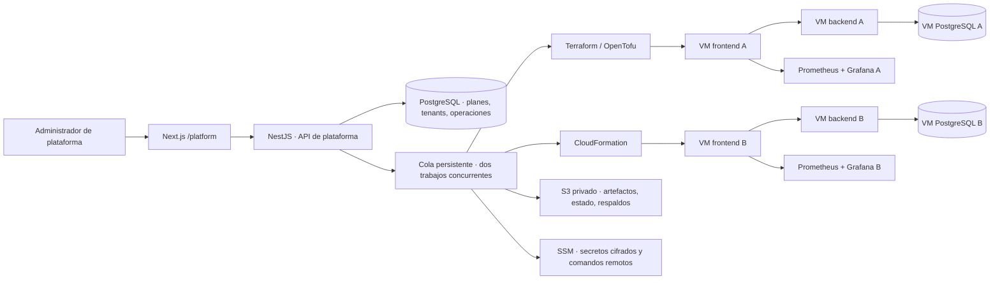

# TenantForge · Proyecto final

El alcance de esta entrega es la plataforma multiinstitución descrita en **Requisitos del proyecto finalv2.pdf**. La aplicación de asistencia es la carga de trabajo desplegada para cada institución (RF-21), no la totalidad del proyecto.

## Arquitectura



Cada tenant tiene **tres instancias EC2 independientes**: frontend, backend y PostgreSQL. Cada instancia tiene un rol IAM y un security group propios. El frontend publica HTTP; el backend acepta el puerto 3001 solo desde su frontend; PostgreSQL acepta el puerto 5432 solo desde su backend. Los puertos de métricas solo aceptan el frontend del mismo tenant. Las IP públicas de los nodos internos permiten la salida para instalar paquetes y usar SSM, pero sus servicios no se exponen a Internet. El plano de control continúa local para esta presentación.

El identificador aparece en las etiquetas `Name` de AWS (`uagrm-frontend-dev`, `uagrm-backend-dev`, `uagrm-database-dev`) y en la dirección `http://uagrm.<IP-del-frontend>.sslip.io`. Es un hostname DNS real, no una IPv4 modificada. Al reanudar se actualiza la dirección con la nueva IP. El servicio DNS externo no tiene garantía de disponibilidad; producción necesita dominio propio y HTTPS.

## Página pública y solicitudes

- `/`: presentación, planes y formulario sin iniciar sesión; `/login`: acceso; `/platform`: panel protegido.
- Campos: institución, identificador, correo del administrador, contraseña, teléfono, plan, motor, entorno y color.
- Enviar crea una solicitud **PENDING**, sin recursos AWS ni trabajos de despliegue.
- **Solicitudes** permite buscar, filtrar, aprobar y rechazar con motivo. Aprobar crea un tenant y un despliegue de tres instancias; una transacción impide aprobar dos veces.
- Las contraseñas se cifran al recibirlas, nunca aparecen en la bandeja y se eliminan de la solicitud al revisarla. Tras aprobar, la credencial permanece cifrada en el tenant.
- El correo del administrador permite iniciar sesión en su aplicación, además de `admin`.
- El color elegido distingue tarjetas, inventario y aplicación del tenant.
- El formulario tiene validación backend, honeypot y límite por IP. La ruta sin autenticación funciona en el servidor local; no equivale a publicar el plano de control en Internet. No transmitir contraseñas reales por HTTP.

## Arranque

Requisitos: PostgreSQL 17 local, Node.js 24, AWS CLI, Terraform y perfil AWS `iac` válido en `us-east-1`.

```powershell
Set-Location backend
node --env-file=.env scripts/prepare-platform.mjs --publish
Set-Location ..
powershell -ExecutionPolicy Bypass -File .\Start-Platform.ps1
```

Abre http://localhost:3000 para la página pública y http://localhost:3000/login para el acceso administrativo. Usuario local de demostración: `platform`; contraseña inicial: `platform123`. Configura `PLATFORM_ADMIN_PASSWORD` para personalizarla. La configuración privada queda en `backend/.env.platform.local`, excluida de Git.

El preparador usa `platform_mvp` como esquema de control. No modifica los estudiantes del esquema `public` ni los datos de la demostración de asistencia. Publica exclusivamente un paquete de código sin archivos `.env`, dependencias ni estados Terraform.

## Planes

| Plan | Cómputo | Memoria | Disco inicial | Estudiantes | Fechas de clase |
| --- | --- | --- | --- | --- | --- |
| Básico | t3.small | 2 GB | 20 GB | 50 | 50 |
| Estándar | c7i-flex.large | 4 GB | 30 GB | 200 | 200 |
| Avanzado | m7i-flex.large | 8 GB | 50 GB | 1000 | 500 |

La tabla indica recursos **por instancia**; el disco indicado corresponde a PostgreSQL, mientras frontend y backend parten de 20 GB. Cada tenant usa tres instancias del tipo elegido (tres veces el cómputo indicado). La migración conserva cualquier disco existente mayor. Los tipos se ajustan a la lista de instancias habilitadas en la cuenta utilizada. Las cuotas de estudiantes y clases se validan en el backend de cada institución. Editar un plan modifica su catálogo; usa **Actualizar** o **Cambiar plan** en cada tenant para aplicar la configuración al despliegue. Un cambio de plan muestra los recursos afectados antes de confirmar. El disco puede crecer, pero no se reduce automáticamente.

## Operaciones

| Acción | Comportamiento |
| --- | --- |
| Crear | Valida nombre, identificador único, contacto, entorno, plan y motor. Encola el despliegue. |
| Migrar | Respalda la base anterior, conserva la VM como frontend, crea backend y PostgreSQL dedicados, restaura y verifica conteos antes de redirigir el tráfico. El plan se detiene si reemplaza una instancia existente. |
| Desplegar / actualizar | Aplica infraestructura y configuración; comprueba frontend y backend por HTTP. |
| Suspender | Detiene las tres instancias y conserva sus volúmenes y respaldos. El almacenamiento sigue facturándose. |
| Reanudar | Inicia las tres instancias, actualiza sus IP y la dirección DNS y comprueba los servicios. |
| Respaldar | Ejecuta `pg_dump -Fc` en la instancia de base de datos mediante SSM y guarda el respaldo cifrado en S3. |
| Restaurar | Exige confirmación escrita y un respaldo del mismo tenant; detiene temporalmente el backend y ejecuta `pg_restore`. |
| Eliminar | Exige escribir el identificador y tener un respaldo si existe una VM. Elimina cómputo, disco y red del tenant; conserva respaldos e historial. |
| Reintentar | Crea una nueva operación auditada usando el mismo tenant y estado remoto. Mantiene visible el error anterior. |

Cada operación conserva actor, fecha, acción, estado, progreso, logs, error y versiones de aplicación, plantilla y herramienta. PostgreSQL impide dos operaciones activas para el mismo tenant. Tras reiniciar la plataforma, los trabajos interrumpidos aparecen como fallidos y se pueden reintentar; no se presentan como completados.

## Herramientas y estado

- **Terraform**: motor principal. Configuración en `infrastructure/terraform/`; un estado remoto S3 por identificador de tenant, cifrado en reposo, con bloqueo nativo `use_lockfile`. Credenciales del tenant se almacenan en SSM SecureString, no en variables del estado.
- **OpenTofu**: usa el mismo adaptador declarativo cuando su CLI está instalado. No se instaló ni se ejecutó en la preparación inicial.
- **CloudFormation**: segundo motor ejecutable en `infrastructure/cloudformation/tenant.json`. Mantiene sus recursos en un stack independiente por tenant. El adaptador conserva las definiciones de las instancias existentes y revisa el change set antes de ejecutarlo; rechaza reemplazos de máquinas para proteger los datos. La configuración de servicios se actualiza por SSM. Los cambios de plan de infraestructura están habilitados para Terraform; el adaptador CloudFormation los rechaza explícitamente para evitar reemplazar una instancia que contiene datos.
- **Pulumi**: comparación técnica: permitiría tipar y reutilizar la infraestructura en TypeScript, pero requiere su CLI, SDK, backend de estado y un adaptador propio. No se anuncia como motor funcional en esta entrega; el selector lo muestra deshabilitado.
- **cloud-init**: instala AWS CLI, descarga el paquete privado y ejecuta el bootstrap al crear una máquina.
- **Ansible**: playbook de configuración posterior en `infrastructure/ansible/configure.yml`, con transporte SSM. Requiere Ansible, la colección `amazon.aws` y el plugin de Session Manager. Plantilla preparada; su ejecución no forma parte del flujo probado de la demo.
- **Packer**: plantilla en `infrastructure/packer/tenant.pkr.hcl` para producir una imagen base y reducir la instalación inicial. No se construyó una AMI de Packer durante esta demo; las instancias probadas parten de Ubuntu 24.04 de Canonical.

Los workspaces locales de cada tenant se guardan en `.runtime/tenants/<id>`, ignorados por Git. No elimines estos directorios durante una operación. Las claves de cifrado y las credenciales AWS no se publican en el repositorio.

## Grafana y alertas

Cada tenant instala Prometheus y Grafana en su frontend, Node Exporter en las tres máquinas y PostgreSQL Exporter en la base dedicada. El enlace **Grafana** abre `/grafana/d/attendance-tenant`. Usuario `admin` y contraseña inicial elegida para la institución. El dashboard muestra CPU y memoria por rol, disponibilidad de cada una de las tres instancias, latencia y errores del backend, estudiantes y conectividad real a PostgreSQL.

Las reglas se versionan en `infrastructure/monitoring/alerts.yml`. **Probar alerta** activa una métrica de prueba en la VM mediante SSM; Prometheus evalúa una alerta real y la plataforma la recoge en su siguiente consulta. **Resolver prueba** desactiva esa métrica. Las comprobaciones de disponibilidad fallidas también generan eventos visibles con institución y hora.

## Seguridad y retención de la demostración

- El acceso HTTP se restringe a la IP pública detectada al preparar el entorno. Si cambia tu red, actualiza `PLATFORM_ALLOWED_CIDR` y aplica la infraestructura.
- Esta presentación utiliza HTTP restringido por IP. Para producción se requiere dominio y HTTPS antes de abrir el acceso público.
- Los secretos se cifran con AES-256-GCM en la base de control y se entregan a EC2 por SSM SecureString. Conserva `SESSION_SECRET`: cambiarlo sin migrar los secretos cifrados impide descifrarlos.
- Los respaldos se conservan hasta una eliminación explícita. Eliminar un tenant no elimina su historial en la plataforma ni sus respaldos en S3.
- Usa **Suspender** para detener cómputo al terminar. EBS, S3 y otros recursos retenidos pueden seguir generando cargos. Para eliminar recursos del tenant, crea un respaldo y utiliza la confirmación de eliminación.

## Evidencia y pruebas

```powershell
Set-Location backend
npm test
npm run test:e2e
Set-Location ../frontend
npm run test:e2e
```

La suite backend usa un esquema PostgreSQL temporal, sin aprovisionar recursos AWS. Comprueba autenticación, separación de roles, cifrado de credenciales, cola persistente, exclusión de operaciones simultáneas, reintentos, filtros, auditoría y el flujo de asistencia. Las pruebas de navegador de plataforma usan un entorno local ya iniciado y no crean VMs.

Las pruebas de aislamiento AWS deben usar dos instituciones desplegadas: importar el mismo número de registro con nombres diferentes, obtener una sesión en cada tenant y comprobar que el token de A obtiene 401 al consultar B. No basta con cambiar un identificador en la interfaz; la comprobación debe realizarse contra la API.

## Verificar la arquitectura de tres instancias

Desde `backend/`, con la plataforma iniciada:

```powershell
node --env-file=.env.platform.local scripts/verify-three-tier.mjs
```

Esta comprobación consulta AWS, prueba el inicio de sesión por correo y verifica nombres, tres IDs distintos, servicios en sus máquinas correspondientes, puertos protegidos, exporters, conservación de datos y rechazo de tokens entre instituciones. No crea ni elimina infraestructura. Guarda el resultado en `.runtime/three-tier-verification.json`; debe indicar `passed: true`. Las capturas de página pública, solicitudes, inventario y Grafana están en `.runtime/evidence/`.

Para migrar instituciones antiguas existe `scripts/migrate-three-tier.mjs --execute`; crea recursos facturables, requiere el entorno `.env.platform.local` y conserva al finalizar el estado suspendido de las instituciones que estaban suspendidas. La plataforma también permite migrar desde la ficha de cada institución con confirmación escrita.

La cuota EC2 de esta cuenta puede impedir crear otro tenant mientras están activos dos tenants de tres instancias. Suspende uno antes de una nueva demostración de aprovisionamiento o solicita ampliar la cuota. Los planes siguen limitando estudiantes en el backend, independientemente de la cantidad de máquinas.

## Presentación y límites del MVP

El [guion de presentación](PRESENTACION.md) recorre las instituciones y operaciones reales. `backend/scripts/verify-cloud.mjs --lifecycle` verifica el despliegue y ejecuta operaciones sobre las dos instituciones de demostración; guarda resultados en `.runtime/cloud-verification.json`. Este archivo debe indicar `passed: true` antes de afirmar que todas esas pruebas pasaron.

No se implementó un portal o rol docente independiente. Ansible y Packer tienen plantillas preparadas, sin evidencia de ejecución. Pulumi tiene comparación documentada y OpenTofu un adaptador compatible que necesita su CLI. El plano de control sigue siendo local y el acceso de demostración utiliza HTTP restringido por IP. No se declara esta entrega como lista para producción.
