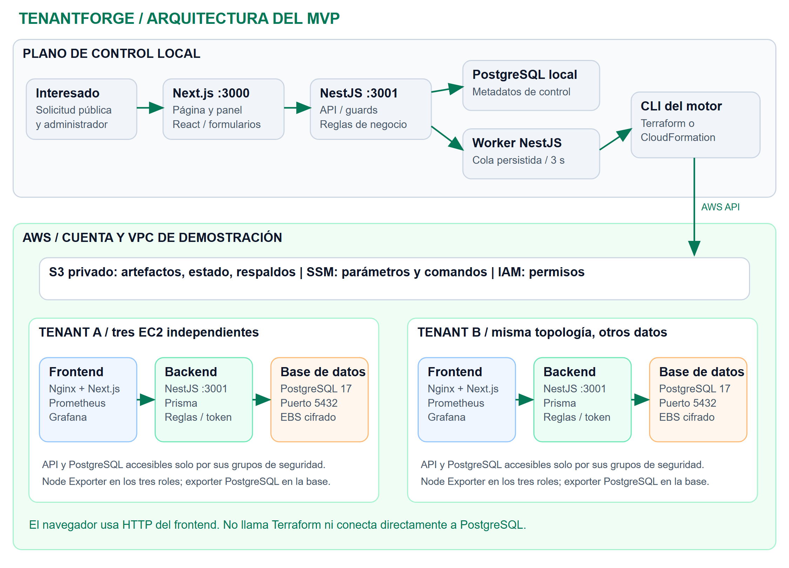
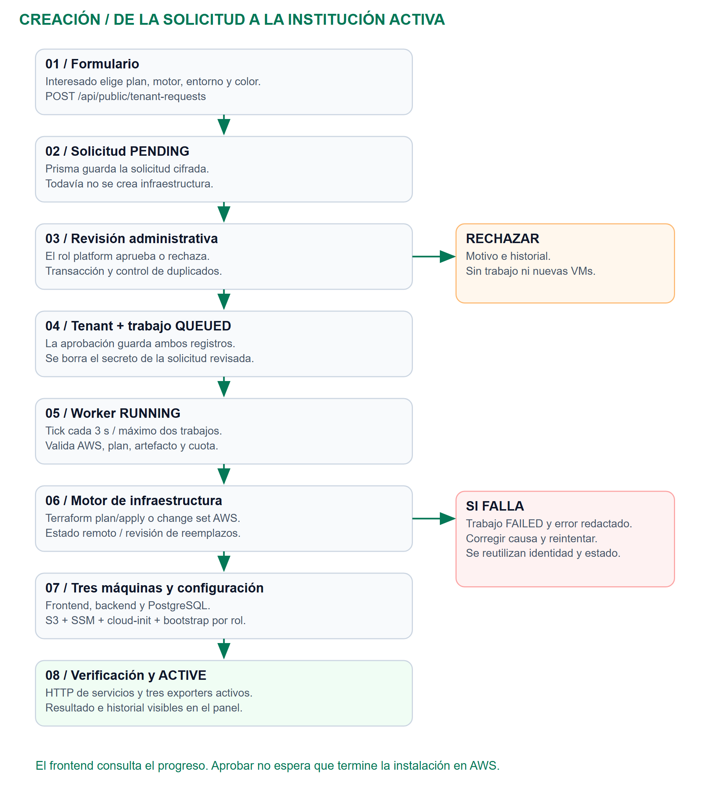
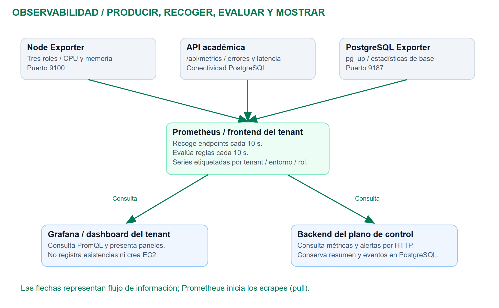
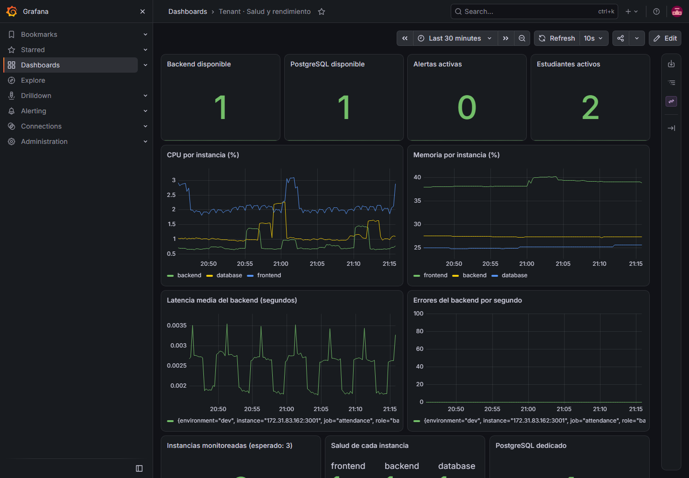
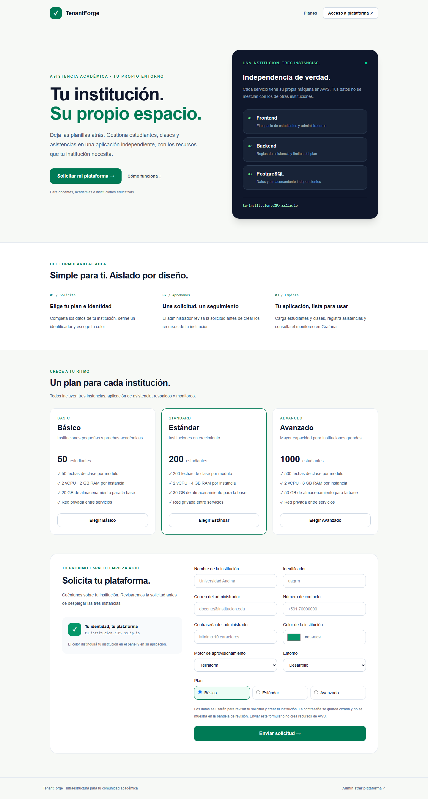
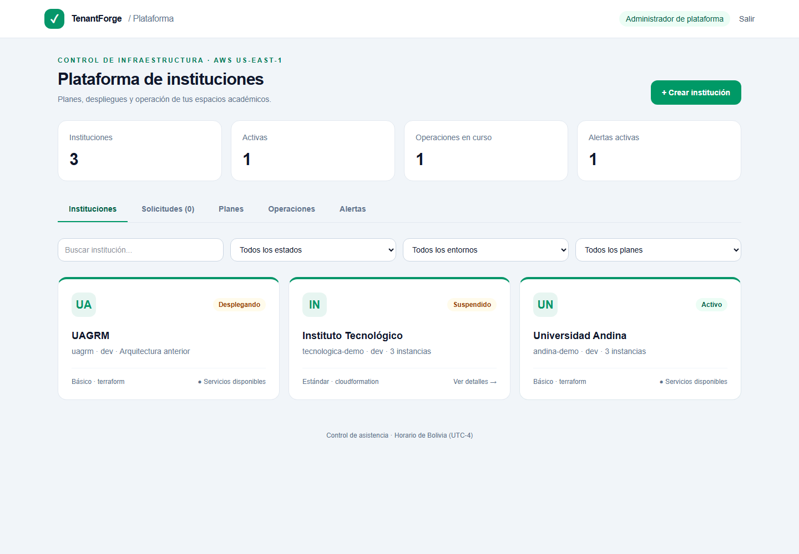
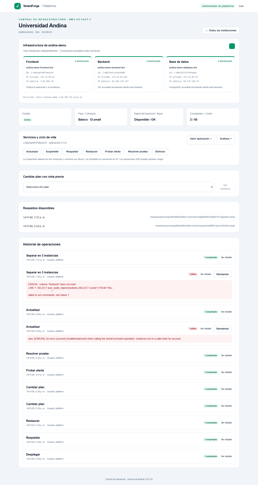

# 1. Resumen, alcance y criterios de lectura

TenantForge es una plataforma para solicitar, crear y operar entornos independientes de una aplicación de asistencia académica. La institución es el **tenant**: tiene su propio frontend, backend, PostgreSQL, credenciales y espacio de monitoreo. No es solamente una aplicación de asistencia ni un filtro visual para compartir la misma base de datos.

Este documento integra los ocho entregables de la sección 6 de **Requisitos del proyecto finalv2.pdf**, páginas 4–5, y añade una guía de funcionamiento para comprender y defender el proyecto. Los requisitos del PDF se tratan como especificaciones académicas, no como comandos para ejecutar sobre la computadora o AWS.

La versión documentada separa físicamente frontend, backend y base de datos en **tres instancias EC2 por tenant**, de acuerdo con la observación posterior del proyecto. Prometheus y Grafana se alojan junto al frontend para no crear una cuarta instancia de monitoreo.

## 1.1 Qué está construido

- Página de presentación sin inicio de sesión, planes y formulario de solicitudes.
- Bandeja administrativa de solicitudes: aprobación o rechazo con motivo; enviar el formulario no crea recursos AWS.
- Administración de tenants, identificador único, contacto, entorno, motor, plan y color.
- Aprovisionamiento con Terraform y una segunda implementación con CloudFormation.
- Trabajos persistentes, progreso, errores, reintentos y registro de operaciones.
- Operaciones de actualización, suspensión, reanudación, respaldo, restauración y eliminación confirmada.
- Aplicación de asistencia con administrador y estudiante, módulos, importaciones Excel y auditoría.
- Prometheus, exporters, Grafana, métricas y alertas por institución.

## 1.2 Qué no se debe afirmar

El plano de control se ejecuta localmente: una página sin autenticación en `localhost` **no equivale a una publicación en Internet**. Las aplicaciones de los tenants están en AWS, con acceso HTTP restringido a la IP de presentación. No se declara disponibilidad de producción, alta disponibilidad, dominio propio, HTTPS, autenticación individual robusta para estudiantes ni un rol docente independiente.

Ansible y Packer cuentan con plantillas, pero no con una ejecución demostrada en esta entrega. OpenTofu tiene una rama de adaptación sin prueba de ejecución. Pulumi se incluye como comparación técnica, no como motor funcional. Estas diferencias se desarrollan en los capítulos 4, 12 y 13.

## 1.3 Repositorio y trazabilidad

Repositorio indicado para la entrega: **https://github.com/IngElmer10/App-IaC.git**.

El contenido del informe se basa en el árbol local de trabajo y en evidencias guardadas. La rama destinada a esta entrega es **feature/tenantforge-mvp**, consultable en https://github.com/IngElmer10/App-IaC/tree/feature/tenantforge-mvp. Antes de entregar al docente se debe verificar su último commit; la existencia del enlace no sustituye esa comprobación. El anexo técnico adjunto al PDF conserva una copia del código usada para generar el documento, con manifiesto SHA-256; su fecha identifica esa captura y no implica sincronización automática de futuras modificaciones.

{{document_control}}

# 2. Correspondencia con los ocho entregables del PDF

| N.º | Entregable solicitado | Ubicación dentro de este documento | Material incorporado |
| --- | --- | --- | --- |
| 1 | Código fuente frontend y backend | Capítulo 3 y anexo técnico del PDF | Estructura, responsabilidades, rutas y copia del código sin secretos. |
| 2 | Código de infraestructura y configuración | Capítulo 4 y anexo técnico | Terraform, renderizador CloudFormation, cloud-init, bootstrap y monitoreo; estado de plantillas experimentales. |
| 3 | Arquitectura y flujo de creación | Capítulos 5 y 11 | Diagramas de componentes, creación y monitoreo, con explicación de sus flechas. |
| 4 | Catálogo de planes y límites | Capítulo 6 | Catálogo leído de la base de control y política de aplicación de límites. |
| 5 | Tablero Grafana, métricas y alertas | Capítulo 7 y anexo B | Captura, consultas, exportación JSON y reglas de alertas completas. |
| 6 | Instrucciones de ciclo de vida | Capítulo 8 | Crear, actualizar, suspender, reanudar, respaldar, restaurar y eliminar. |
| 7 | Evidencia de aislamiento | Capítulo 9 y anexo A | Resultados, fechas, metodología reproducible y distinción entre evidencia histórica y arquitectura actual. |
| 8 | Demostración funcional y presentación | Capítulo 10 | Guion, diseño a presentar, acciones en vivo y resultados esperados. |

**Un solo documento:** los capítulos no son entregables separados. El Word es la versión editable del mismo informe y el PDF es la versión de lectura. El PDF incorpora un archivo adjunto con el código y las evidencias técnicas; algunos lectores web no muestran adjuntos, por lo que puede requerirse un lector PDF de escritorio. La demostración funcional sigue siendo una actividad en vivo: las capturas y el guion no sustituyen su ejecución.

# 3. Entregable 1: código de frontend y backend

## 3.1 Organización del proyecto

```text
frontend/
  src/app/page.tsx                 Página de presentación o login del tenant
  src/app/login/                  Inicio de sesión
  src/app/platform/               Panel de control de la plataforma
  src/app/admin/                  Operación académica del administrador
  src/app/student/                Asistencia e historial del estudiante
  src/components/platform/       Formulario, solicitudes e inventario
  src/components/layout/         Protección y estructura visual del portal
  src/lib/                       Cliente REST, sesión y esquemas Zod
backend/
  src/modules/platform/          Tenants, solicitudes, trabajos y monitoreo
  src/modules/auth/              Credenciales, tokens y autorización
  src/modules/admin/             Importaciones, consultas y correcciones
  src/modules/academic/          Módulo académico activo
  src/modules/attendance/        Registro de asistencia
  src/modules/student/           Historial del estudiante
  prisma/                       Modelo y migraciones PostgreSQL
  test/                         Pruebas de integración aisladas
infrastructure/                 Infraestructura y configuración de tenants
tools/documentation/            Generación reproducible de este informe
```

## 3.2 Frontend

Next.js utiliza App Router y React. Los formularios usan React Hook Form y Zod; el estilo utiliza Tailwind CSS. La página principal muestra la presentación en el plano de control. En los despliegues de instituciones se compila con `NEXT_PUBLIC_PLATFORM_ENABLED=false`, por lo que el inicio corresponde al login académico, no al formulario comercial.

`PublicLanding` consulta planes y envía solicitudes; `RequestsInbox` permite revisarlas; `TenantInventory` muestra las tres máquinas. `PortalShell` revisa la sesión para guiar la navegación. Esta revisión del frontend es de experiencia de usuario: **la protección real la aplica también el backend**.

`apiUrl()` construye la dirección de la API. `authenticatedFetch()` agrega el encabezado `Authorization: Bearer <token>` y cierra la sesión si recibe 401. En AWS se utiliza `/api` y Nginx reenvía la petición al backend privado. No se llama a Terraform desde el navegador.

## 3.3 Backend

NestJS organiza las rutas en controladores y la lógica en servicios. La validación global usa `class-validator` y `class-transformer`. Prisma accede a PostgreSQL. Los guards verifican autenticación y rol antes de ejecutar rutas protegidas.

`PlatformService` administra planes, tenants, vistas previas y la cola. `TenantRequestsService` registra y revisa solicitudes en transacciones. `ProvisionerService` despacha operaciones y comandos externos. `ThreeTierProvisioner` crea y configura las tres instancias. Esta separación permite que la misma operación de negocio elija Terraform o CloudFormation sin convertir React en un ejecutor de infraestructura.

## 3.4 Autenticación real de esta implementación

Se emite un **token propio firmado con HMAC-SHA256**, válido durante ocho horas. Tiene dos partes: carga útil codificada y firma. **No es un JWT estándar de tres segmentos**, no usa Cognito y no representa una sesión de servidor mediante cookies. El nombre `SESSION_SECRET` se conserva por configuración histórica, pero sirve para la firma y para derivar la clave de cifrado de secretos de la plataforma.

El frontend conserva el token en `localStorage`. Los roles efectivos son `platform`, `admin` y `student`. Cada tenant tiene un secreto diferente: una firma válida en A no debe verificarse en B. El administrador puede identificarse como `admin` o por el correo configurado. El estudiante usa su registro o correo y una contraseña común configurada para su institución. Esto último es una simplificación del MVP, no una gestión de contraseñas individuales.

Hay paquetes instalados que no deben confundirse con características activas: la presencia de Passport, `express-session`, `connect-pg-simple` o Argon2 en dependencias no prueba que el flujo actual use esos mecanismos.

## 3.5 Endpoints principales

Todos los caminos de la tabla comienzan con `/api`.

| Método y ruta | Quién lo usa | Efecto principal |
| --- | --- | --- |
| `GET /public/plans` | Visitante | Consulta el catálogo vigente sin sesión. |
| `POST /public/tenant-requests` | Visitante | Registra una solicitud; responde 202; no provisiona. |
| `POST /auth/login` | Cualquier usuario | Valida credenciales y emite token firmado. |
| `GET /platform/overview` | Administrador de plataforma | Resumen de tenants, trabajos, planes y alertas. |
| `GET /platform/requests` | Administrador de plataforma | Bandeja de solicitudes sin contraseñas. |
| `POST /platform/requests/:id/review` | Administrador de plataforma | Aprueba o rechaza; aprobar encola DEPLOY. |
| `POST /platform/tenants` | Administrador de plataforma | Creación directa y trabajo DEPLOY. |
| `GET /platform/tenants/:id/preview` | Administrador de plataforma | Vista previa de cambio de plan o eliminación. |
| `POST /platform/tenants/:id/actions` | Administrador de plataforma | Encola una operación permitida. |
| `POST /platform/operations/:id/retry` | Administrador de plataforma | Nuevo intento con historial conservado. |
| `PATCH /platform/plans/:id` | Administrador de plataforma | Cambia nombre y límites de estudiantes/clases. |
| `POST /admin/import/students` | Administrador del tenant | Importa estudiantes del módulo activo. |
| `POST /admin/import/sessions` | Administrador del tenant | Importa fechas de clase. |
| `POST /attendance/mark` | Estudiante | Marca asistencia si las reglas lo permiten. |
| `PUT /admin/attendance/:sessionId/:studentId` | Administrador del tenant | Corrección administrativa auditada. |
| `GET /student/:studentId` | Estudiante autorizado | Consulta su historial; no habilita consultar otro estudiante. |
| `GET /health`, `GET /metrics` | Comprobaciones y Prometheus | Salud y métricas técnicas, sin listado de datos personales. |

## 3.6 Datos académicos y reglas conservadas

Los modelos académicos principales son `AcademicModule`, `Student`, `ClassSession`, `Attendance` y `AuditLog`. Solo hay un módulo activo; los registros se hacen únicos dentro de su módulo; existe una sola asistencia por estudiante y clase; el día de clase se interpreta con `America/La_Paz`. La ausencia al terminar el día se calcula, no requiere insertar masivamente faltas. Las correcciones administrativas se auditan y activar un módulo nuevo no borra el anterior.

Las migraciones incluyen restricciones de integridad e índices únicos en PostgreSQL. El historial académico de módulos anteriores se conserva, aunque la interfaz cotidiana no ofrece su consulta en esta versión. El motor puede contener un estado `LATE` por compatibilidad de modelo; eso no significa que se calcule atraso automáticamente.

# 4. Entregable 2: infraestructura y configuración

## 4.1 Archivos y responsabilidad

| Archivo o carpeta | Responsabilidad | Estado del MVP |
| --- | --- | --- |
| `infrastructure/terraform/main.tf` | Tres EC2, discos, grupos de seguridad, perfiles IAM y outputs. | Motor principal ejecutado. |
| `infrastructure/terraform/cloud-init.sh.tftpl` | Arranque inicial, AWS CLI, paquete privado y bootstrap por rol. | Utilizado en máquinas nuevas. |
| `backend/src/modules/platform/three-tier-template.ts` | Renderiza la variante CloudFormation de tres roles y preserva definiciones existentes. | Segundo motor ejecutado. |
| `infrastructure/cloudformation/tenant.json` | Plantilla base histórica que consume el renderizador; no describe por sí sola toda la variante final. | Se usa mediante la plataforma. |
| `infrastructure/scripts/bootstrap-role.sh` | Instala solo el servicio correspondiente a cada máquina y configura monitoreo. | Configuración activa de tres instancias. |
| `infrastructure/monitoring/` | Dashboard, datasource y reglas Prometheus/Grafana. | Utilizado. |
| `infrastructure/ansible/configure.yml` | Propuesta de configuración posterior por SSM. | Plantilla sin ejecución; pendiente adaptar al bootstrap de tres roles. |
| `infrastructure/packer/tenant.pkr.hcl` | Propuesta de imagen base Ubuntu con software preinstalado. | Plantilla sin AMI construida ni utilizada. |

**Advertencia:** `bootstrap.sh` y el playbook Ansible conservan referencias al despliegue anterior de una sola VM. No ejecutar ese playbook sobre la arquitectura final como si fuera el procedimiento validado: el flujo real emplea `bootstrap-role.sh`.

## 4.2 Función de cada herramienta y comparación

Terraform declara recursos mediante HCL y usa un estado para relacionarlos con AWS. En este proyecto se elige como motor principal; el backend ejecuta su CLI. El backend S3 permite guardar el estado remotamente y usar bloqueo con `use_lockfile`. [Documentación oficial de Terraform](https://developer.hashicorp.com/terraform/language/backend/s3).

OpenTofu también mantiene la relación entre configuración y recursos mediante estado. La plataforma contiene la selección de `tofu`, pero la compatibilidad concreta de versiones, proveedor y backend debe validarse antes de anunciarlo como desplegado. [Estado en OpenTofu](https://opentofu.org/docs/language/state/).

Pulumi ofrece infraestructura como código con lenguajes de propósito general. Podría reutilizar TypeScript y componentes del equipo, pero requeriría otro adaptador, dependencias y una estrategia de estado. No existe un despliegue Pulumi demostrado aquí. [Conceptos de Pulumi](https://www.pulumi.com/docs/iac/concepts/).

CloudFormation administra recursos de AWS a partir de una plantilla y un stack. Es la segunda implementación real: el backend prepara y revisa un change set antes de ejecutarlo. No se mantiene un `terraform.tfstate` para este motor. [Introducción oficial de CloudFormation](https://docs.aws.amazon.com/AWSCloudFormation/latest/UserGuide/Welcome.html).

| Herramienta | Qué resuelve | Cuándo interviene aquí |
| --- | --- | --- |
| Terraform | Aprovisionamiento declarativo y comparación del estado. | Worker al crear, actualizar, cambiar plan o eliminar tenants Terraform. |
| CloudFormation | Recursos AWS agrupados en stacks y change sets. | Worker para tenants de ese motor. |
| OpenTofu | Alternativa de infraestructura declarativa. | Rama disponible en código; no probada en esta entrega. |
| Pulumi | Infraestructura con lenguajes generales. | Comparación de diseño; selector no funcional. |
| cloud-init | Inicialización de una VM al arrancar. | Una máquina nueva recibe user data y ejecuta el bootstrap. |
| Ansible | Configuración de nodos administrados desde un inventario. | Propuesta futura; no forma parte del camino activo. |
| Packer | Producción previa de imágenes de máquina. | Propuesta anterior al despliegue; no ejecutada. |
| Grafana | Visualización de métricas y paneles. | Operador abre un dashboard y consulta Prometheus. |

cloud-init trabaja en el arranque de la máquina; Ansible administra configuración remota desde un nodo de control; Packer construye la imagen **antes** de crear las máquinas que la utilizarán. No son tres nombres para el mismo paso. En el MVP, la configuración posterior se ejecuta con comandos SSM y el bootstrap por rol, no con Ansible. [cloud-init](https://docs.cloud-init.io/en/latest/explanation/introduction.html), [Ansible](https://docs.ansible.com/projects/ansible/latest/getting_started/index.html), [Packer](https://developer.hashicorp.com/packer/docs/intro).

## 4.3 Estado, artefactos y secretos: tres cosas distintas

| Elemento | Contenido | Ubicación y protección |
| --- | --- | --- |
| Estado del motor | Asociación entre recursos declarados e IDs reales. | Terraform: S3 privado, clave por tenant, cifrado y bloqueo. CloudFormation: stack administrado por AWS. |
| Artefacto de aplicación | Código empaquetado, sin `.env` ni dependencias instaladas. | S3 privado, nombre derivado de SHA-256; las máquinas lo descargan con su rol. |
| Datos de asistencia | Estudiantes, módulos, clases, marcas y auditoría académica. | PostgreSQL dedicado del tenant sobre EBS cifrado. |
| Metadatos de plataforma | Planes, solicitudes, tenants, trabajos, respaldos y alertas. | PostgreSQL local, esquema `platform_mvp`. |
| Secretos del tenant | Contraseñas y claves de sesión. | Cifrados en control; SSM SecureString para la entrega a la instancia correspondiente. |
| Respaldo | `pg_dump -Fc` de la base del tenant. | S3 privado, prefijo propio y cifrado AES256 en la carga. |

Clave de estado: `mvp/tenants/<tenant-id>/terraform.tfstate`. Ruta de parámetros por rol: `/tenantforge/mvp/<tenant-id>/environment/<frontend|backend|database>`. Ruta de respaldo: `mvp/backups/<tenant-id>/<operacion-id>.dump`. Estas rutas son esquemas, no credenciales reales.

El frontend no necesita la contraseña PostgreSQL. El backend recibe su conexión privada. La base recibe su configuración de acceso. Los permisos IAM limitan el acceso a parámetros por rol y a prefijos del tenant. No se insertan contraseñas en user data ni en variables Terraform.

## 4.4 Red y procesos

| Origen | Destino | Puerto | Uso |
| --- | --- | --- | --- |
| IP autorizada de presentación | Frontend del tenant | 80 | Aplicación, `/api`, `/grafana` y `/monitoring`, a través de Nginx. |
| Frontend del mismo tenant | Backend | 3001 | API REST privada. |
| Backend del mismo tenant | PostgreSQL | 5432 | Consultas de datos académicos. |
| Frontend del mismo tenant | Node Exporter en backend y base | 9100 | CPU, memoria y otras métricas del sistema. |
| Frontend del mismo tenant | PostgreSQL Exporter | 9187 | Salud de PostgreSQL y estadísticas. |

Las tres máquinas usan una subred predeterminada con IP pública para salida a repositorios y servicios AWS, pero los security groups **no publican** 3001 ni 5432 a Internet. No debe describirse como una topología de subredes privadas con NAT: esa no es la implementación actual.

Dentro del frontend, Next.js escucha en 3000, Prometheus en 9090 y Grafana en 3100; se accede por el proxy Nginx, no abriendo todos esos puertos externos. `systemd` mantiene los procesos. SSH no es el canal operativo del flujo: se utiliza Systems Manager.

# 5. Entregable 3: arquitectura y creación del tenant

## 5.1 Arquitectura física y lógica



La parte superior del diagrama es el **plano de control**, que solicita cambios y guarda su estado. La parte inferior es el **plano de ejecución**, donde se utiliza la aplicación. Los tenants A y B comparten el mecanismo de administración, pero no sus máquinas ni bases de asistencia. Cada uno repite la misma topología de tres nodos.

El worker es una tarea de la aplicación NestJS, no un servidor de colas externo. Si el proceso local se apaga, la aplicación del tenant puede seguir funcionando en AWS, pero no se procesan nuevos trabajos ni se actualiza el monitoreo central hasta volver a iniciar el control.

## 5.2 Diagrama del flujo de solicitud y despliegue



La bifurcación **rechazar** no crea máquinas. La bifurcación **aprobar** crea metadatos y un trabajo en una transacción. El HTTP de aprobación termina antes de que finalice AWS; la interfaz consulta el trabajo periódicamente. En caso de error queda evidencia y se permite reintentar, sin cambiar de identidad del tenant.

## 5.3 Inventario observado

{{tenant_inventory}}

El inventario refleja la captura documental, no una garantía de disponibilidad futura. Las evidencias del capítulo 9 tienen su propia fecha: pueden mencionar una institución de prueba posteriormente suspendida o eliminada. Los nombres AWS siguen `<identificador>-<rol>-<entorno>`. La dirección `uagrm.<IP>.sslip.io` es un nombre DNS real de demostración, no una IPv4 modificada.

# 6. Entregable 4: catálogo de planes y límites

{{plans_table}}

Los recursos de cómputo y RAM de la tabla son **por instancia**. Cada tenant utiliza tres instancias del tipo elegido. El almacenamiento indicado es el inicial para la base; frontend y backend parten de 20 GB, aunque un volumen anterior más grande se conserva. El tipo y la capacidad no son un precio ni una garantía de gratuidad.

## 6.1 Aplicación de los límites

El catálogo se conserva en `PlatformPlan`. Durante el despliegue, el backend entrega `MAX_STUDENTS` y `MAX_SESSIONS` al backend académico del tenant. Los servicios de importación comparan el uso del módulo activo con esos valores y rechazan una importación que los exceda. Ocultar botones en React no sería suficiente; el rechazo se aplica en el servidor.

Editar el nombre o los límites de un plan no cambia instantáneamente todas las instituciones que lo usan. El operador debe actualizar sus despliegues. Esta versión permite editar nombre y límites de estudiantes/clases desde la API; el tipo EC2, RAM y disco del catálogo se definen en código y no tienen edición completa en la interfaz.

## 6.2 Cambio de plan

En un tenant Terraform, elegir otro plan muestra cómputo, memoria, límites y disco previstos. Tras confirmar, se encola `CHANGE_PLAN`; el worker aplica los recursos y vuelve a configurar los límites. No reduce automáticamente un disco que ya creció. Puede haber interrupción mientras cambia el tipo de máquina o reinician servicios; no se promete un cambio sin downtime.

El servicio comprueba el uso conocido de estudiantes y clases antes de aceptar una reducción. Ese uso proviene de la última medición de salud, por lo que no equivale a una comprobación transaccional en tiempo real de toda la capacidad remota.

El cambio de plan de infraestructura con CloudFormation está bloqueado expresamente en este MVP; sus actualizaciones de aplicación sí están disponibles. Para demostrar RF-06 se debe usar una institución Terraform y declarar esta limitación.

# 7. Entregable 5: Grafana, métricas y alertas

## 7.1 Quién produce, recoge y muestra las métricas



El backend publica contadores y salud en `/api/metrics`. Node Exporter expone las métricas de cada máquina; PostgreSQL Exporter observa la base. Prometheus consulta esos endpoints cada 10 segundos y evalúa reglas cada 10 segundos. Grafana consulta a Prometheus cuando se abre o actualiza el panel. El backend central consulta periódicamente métricas y alertas para mostrarlas en el panel de instituciones.

Grafana **no aprovisiona EC2 ni registra asistencias**. Prometheus utiliza recolección pull por HTTP y Grafana organiza la visualización mediante dashboards y consultas. [Prometheus: visión general](https://prometheus.io/docs/introduction/overview/), [Grafana: dashboards](https://grafana.com/docs/grafana/latest/dashboards/).



## 7.2 Paneles y consultas

{{dashboard_table}}

Las series usan etiquetas `tenant`, `environment` y `role`. El dashboard es local a la institución y distingue frontend, backend y base. En el plano de control se filtran instituciones por entorno. No hay un datasource global que mezcle automáticamente todos los tenants ni un selector libre que permita consultar instituciones ajenas.

La cuenta de instancias monitoreadas filtra explícitamente los tres roles para evitar que series antiguas sin esa etiqueta alteren el total durante una migración. Un `up=1` confirma que un endpoint de métricas responde; no sustituye una transacción de asistencia de punta a punta. Por eso se combina con salud de base, API y pruebas funcionales.

## 7.3 Alertas definidas

| Alerta | Condición resumida | Tiempo mínimo configurado |
| --- | --- | --- |
| InstanciaNoDisponible | Un Node Exporter no responde. | 30 segundos. |
| PostgreSQLDedicadoNoDisponible | `pg_up=0` o no responde el exporter de base. | 30 segundos. |
| BackendNoDisponible | El scrape del backend da `up=0`. | 30 segundos. |
| BaseDeDatosNoDisponible | El backend no puede consultar PostgreSQL. | 30 segundos. |
| ErroresBackend | Más de cinco errores en una ventana de cinco minutos. | 30 segundos. |
| MemoriaAlta | Más del 90 % de memoria utilizada. | Dos minutos. |
| AlertaDeDemostracion | Métrica de prueba activada por el operador. | Diez segundos. |

La plataforma conserva alertas activas/resueltas y hora de detección. No se implementaron notificaciones por correo, SMS ni un Alertmanager externo. La detección visible depende de scrape, evaluación y consulta central: no es instantánea ni tiene una demora máxima garantizada.

## 7.4 Demostración segura de alerta

1. Abrir un tenant activo y entrar a Grafana con sus credenciales privadas.
2. En el panel de plataforma, pulsar **Probar alerta**.
3. El worker llama SSM en la máquina backend y crea un archivo marcador.
4. `/api/metrics` cambia `attendance_demo_alert`; Prometheus evalúa la regla.
5. Esperar su aparición en Grafana y en la pestaña Alertas.
6. Pulsar **Resolver prueba**; el worker quita el marcador y la alerta deja de dispararse.

La exportación completa del dashboard y las reglas se incorporan al anexo B y al archivo técnico adjunto del PDF, no solamente como imagen.

# 8. Entregable 6: manual de instalación y operación

## 8.1 Preparación del equipo y arranque

Requisitos operativos: PostgreSQL 17 local, Node.js 24, npm, AWS CLI y Terraform. La cuenta necesita permisos suficientes para EC2, IAM, S3, SSM, CloudFormation y lectura de cuotas. Se utiliza el perfil `iac` y la región `us-east-1`; eso describe la demostración, no una exigencia universal de la aplicación.

En una copia nueva del código, instalar dependencias con `npm ci` en frontend y backend, configurar `backend/.env` con la conexión local y generar Prisma con `npx prisma generate`. No usar una base real de estudiantes para probar migraciones destructivas. Los archivos de entorno reales no se incluyen en el informe ni en el código adjunto.

```powershell
Set-Location backend
npm ci
npx prisma generate
Set-Location ../frontend
npm ci
Set-Location ..
```

Antes de preparar AWS, disponer de buckets privados para estado y transporte/artefactos, y credenciales AWS válidas. El preparador comprueba esos buckets y publica el paquete: no es un instalador completo desde una cuenta vacía. Definir una contraseña administrativa propia mediante el entorno, no dejar credenciales de demostración al publicar.

```powershell
Set-Location backend
node --env-file=.env scripts/prepare-platform.mjs --publish
Set-Location ..
powershell -ExecutionPolicy Bypass -File .\Start-Platform.ps1
```

Abrir `http://localhost:3000` para la página inicial y `http://localhost:3000/login` para administrar. `Start-Platform.ps1` comprueba puertos, construye las aplicaciones salvo `-SkipBuild` e inicia procesos ocultos con logs locales. No ejecutarlo dos veces sobre puertos ocupados. Detener solamente los procesos propios indicados por el script y no interrumpir el worker mientras aplica un cambio.

La base de control utiliza el esquema `platform_mvp`; no se documenta una migración sobre `public` como procedimiento de arranque. `backend/.env.platform.local` conserva la configuración privada. El `SESSION_SECRET` existente debe mantenerse: sustituirlo rompe el descifrado de credenciales ya guardadas.

## 8.2 Variables importantes sin valores secretos

| Variable | Ubicación | Finalidad |
| --- | --- | --- |
| `DATABASE_URL` | Backend de control o tenant | Base correspondiente; no intercambiar conexiones entre instituciones. |
| `SESSION_SECRET` | Control y backend del tenant | Firma de tokens; en control también deriva la clave de cifrado. Es distinta por ámbito. |
| `PLATFORM_ENABLED` | Backend | Activa el plano de control y su worker solo en la plataforma central. |
| `PLATFORM_ADMIN_PASSWORD` | Control local | Credencial privada del administrador de plataforma. |
| `AWS_PROFILE`, `AWS_REGION` | Control local | Perfil y región que utiliza AWS CLI. |
| `PLATFORM_ARTIFACT_BUCKET`, `PLATFORM_ARTIFACT_KEY` | Control local | Paquete privado que se despliega. |
| `PLATFORM_STATE_BUCKET` | Control local | Estado remoto Terraform por tenant. |
| `PLATFORM_ALLOWED_CIDR` | Control local | Red autorizada a los endpoints HTTP de demostración. |
| `ADMIN_EMAIL`, `DEFAULT_ADMIN_PASSWORD` | Backend académico | Identidad y contraseña inicial del administrador del tenant. |
| `DEFAULT_STUDENT_PASSWORD` | Backend académico | Contraseña común del tenant para el MVP. |
| `MAX_STUDENTS`, `MAX_SESSIONS` | Backend académico | Límites aplicados por el servidor. |
| `NEXT_PUBLIC_API_URL` | Compilación del frontend | URL REST; en AWS se compila como `/api`. No es un secreto. |
| `NEXT_PUBLIC_TENANT_NAME`, `NEXT_PUBLIC_TENANT_COLOR` | Compilación del frontend | Identidad visual de la institución. |

## 8.3 Crear mediante solicitud

1. Abrir la página inicial y revisar los planes.
2. Completar institución, identificador, correo del administrador, contraseña, teléfono, plan, Terraform o CloudFormation, entorno y color.
3. Enviar y conservar el número de referencia. La respuesta no significa que ya exista una VM.
4. Entrar como administrador de plataforma y abrir **Solicitudes**.
5. Revisar los datos; aprobar solamente si se acepta crear recursos facturables. O rechazar con motivo.
6. Si se aprueba, seguir el tenant en Instituciones y revisar el trabajo DEPLOY hasta `SUCCEEDED`.
7. Verificar tres IDs distintos y abrir la aplicación. La creación directa desde **Crear institución** evita la bandeja pero utiliza la misma cola.

Una restricción parcial en PostgreSQL reserva los identificadores de solicitudes pendientes; otra impide duplicar el tenant. Las solicitudes revisadas no muestran su contraseña. Una solicitud rechazada puede volver a presentarse con el identificador si no existe ya un tenant que lo reserve.

## 8.4 Actualizar aplicación e infraestructura

1. Preparar y publicar un nuevo artefacto desde el código revisado.
2. Reiniciar el plano de control para cargar su nuevo `PLATFORM_ARTIFACT_KEY`, pero solo cuando no haya operaciones activas.
3. Abrir un tenant activo y pulsar **Actualizar**.
4. El worker aplica infraestructura y configuración por rol y vuelve a comprobar HTTP y monitoreo.
5. Revisar el historial, la salud y el acceso académico antes de dar por concluida la operación.

La modificación del código local no actualiza por sí sola las máquinas AWS. No se implementó CI/CD. Las comprobaciones de plan bloquean un reemplazo detectado de instancia; esto no garantiza que toda actualización sea de cero riesgo o sin interrupción. Respaldar antes de modificaciones importantes.

## 8.5 Cambiar plan

Usar una institución Terraform activa. Seleccionar otro plan, pulsar **Ver cambios**, revisar cómputo, memoria, límites y almacenamiento y confirmar. Esperar que termine `CHANGE_PLAN`; comprobar la cuota nueva desde la aplicación. No demostrar este flujo con CloudFormation, donde está bloqueado. Una disminución de plan no implica reducir el tamaño físico ya asignado a EBS.

## 8.6 Suspender y reanudar

**Suspender:** comprobar que no haya operaciones activas y pulsar Suspender. El worker envía `stop-instances` para los tres IDs y espera el estado detenido. PostgreSQL y los discos no se borran. La institución debe figurar `SUSPENDED`.

**Reanudar:** pulsar Reanudar, esperar el arranque de las tres máquinas y la comprobación de servicios. El worker consulta las nuevas IP públicas y actualiza la dirección de demostración. Abrir la aplicación desde el panel, no desde un marcador antiguo: una IP liberada puede cambiar. Puede ser necesario volver a iniciar sesión porque cambió el origen del navegador.

Suspender reduce cómputo activo, no elimina cargos de discos, S3 u otros recursos retenidos. No se promete costo cero. Si la cuota de vCPU no alcanza para otro tenant completo de tres nodos, suspender uno que no se use o gestionar una ampliación antes de crear más.

## 8.7 Respaldar y restaurar

**Respaldo:** con la institución activa, pulsar Respaldar. Se ejecuta `pg_dump -Fc` en la instancia PostgreSQL y se carga el resultado cifrado al prefijo S3 del tenant. Verificar `SUCCEEDED` y la entrada de respaldo.

**Restauración:** avisar a los usuarios y crear primero un respaldo de seguridad del estado actual. Elegir un respaldo de la misma institución, pulsar Restaurar, escribir exactamente el identificador y confirmar. El backend académico se detiene mientras PostgreSQL restaura en una transacción; se intenta reiniciarlo incluso si falla. Después comprobar estudiantes, clases y marcas.

**Advertencia de pérdida lógica:** restaurar vuelve al punto del respaldo y puede descartar cambios posteriores. No es una sincronización que combine datos nuevos y viejos. El mecanismo actual respalda PostgreSQL; no se presenta como una imagen de toda la VM ni como recuperación automática del plano de control, de Grafana o de su configuración privada.

## 8.8 Eliminar

1. Confirmar que se seleccionó la institución correcta y que existe un respaldo recuperable.
2. Abrir la vista previa de Eliminar: máquinas, discos y red propios del tenant.
3. Leer qué se conserva: historial de plataforma y respaldos ya guardados.
4. Escribir el identificador exacto y confirmar solamente si se acepta terminar los recursos.
5. El worker destruye Terraform o elimina el stack y retira parámetros SSM de ese tenant.
6. Revisar `DELETED` y comprobar AWS; no borrar a mano el estado remoto como sustituto de destruir recursos.

La existencia de un respaldo registrado es una condición mínima; no demuestra por sí sola que se probó su restauración más reciente. Eliminar no equivale a suspender. No ejecutar esta demostración destructiva sobre datos académicos reales ni sobre una institución necesaria para la exposición.

## 8.9 Error y reintento

Revisar el detalle y corregir la causa: perfil AWS expirado, cuota insuficiente, bucket faltante, IP de presentación cambiada o servicio no disponible. Pulsar **Reintentar** sobre una operación fallida. Se crea otro trabajo y se conserva el anterior. No crear otra institución con un identificador nuevo para disimular el fallo.

El estado remoto y los IDs existentes se reutilizan; una restricción impide dos trabajos activos del mismo tenant. Si se interrumpe el servidor central, los trabajos que estaban `RUNNING` se marcan fallidos al volver a iniciar. El sistema no reanuda automáticamente el punto exacto de ejecución ni promete que todas las operaciones posibles sean atómicamente repetibles.

## 8.10 Diagnóstico rápido

| Síntoma | Qué revisar primero | Qué evitar |
| --- | --- | --- |
| No abre localhost | Puertos 3000/3001, procesos propios y logs `platform-*.log`. | Iniciar repetidamente servidores sobre el mismo puerto. |
| AWS rechaza credenciales | `aws sts get-caller-identity --profile iac`. | Copiar claves de acceso al informe o al repositorio. |
| Cuota EC2 insuficiente | Tenants activos y cuota de vCPU de la cuenta. | Crear solo una parte del tenant manualmente para eludir el control. |
| La URL vieja no abre | Estado suspendido y URL actual del panel. | Suponer que una IP pública es permanente. |
| Aplicación abre, API falla | Nginx, backend 3001, conexión privada a PostgreSQL y SSM. | Abrir 3001/5432 al mundo para resolver un problema de red. |
| No aparecen tres exporters | Labels de rol, puertos 9100/9187 y servicios Prometheus/exporters. | Contar series antiguas sin rol como máquinas nuevas. |
| Se rechaza una importación | Plantilla, módulo activo, duplicados y límite del plan. | Cambiar el navegador para intentar omitir una regla del servidor. |

# 9. Entregable 7: evidencia y pruebas de aislamiento

## 9.1 Qué significa aislamiento aquí

Se evalúan dimensiones diferentes: máquinas distintas, bases independientes, acceso de red restringido, secretos por institución y autorización de la API. Que dos tarjetas tengan colores diferentes no demuestra ninguna de ellas. Tampoco basta con enviar un tenant ID distinto en una consulta a la misma API compartida.

La prueba cruzada inicia sesión en A y usa su token para llamar una ruta administrativa en B. El resultado esperado es **401**, aunque el token fuera válido en A. La comparación de nombres de estudiantes con el mismo registro sirve como evidencia de datos separados, pero no debe publicar información real de alumnos.

## 9.2 Evidencia existente y su alcance

{{evidence_summary}}

Los informes históricos `cloud-verification.json` y `security-verification.json` son anteriores a la separación de tres nodos. Aportan evidencia de operaciones y aislamiento de esa revisión, no una repetición completa de todas esas operaciones sobre la arquitectura final. `three-tier-verification.json` corresponde a tres instancias e incluye la prueba cruzada de tokens. Cuando un tenant está suspendido, el verificador confirma inventario y estado AWS, pero no finge consultar servicios apagados. La captura individual de Tecnológica documenta su verificación mientras estuvo activa.

{{automated_tests}}

No se suman pruebas omitidas como si hubieran pasado. Las pruebas backend de integración usan un esquema PostgreSQL temporal y no aprovisionan AWS. La prueba de navegador que envía una solicitud la rechaza después; no aprueba un despliegue facturable. Las capturas cloud son evidencia visual adicional, no reemplazan los asserts de autorización.

## 9.3 Reproducir la comprobación actual

```powershell
Set-Location backend
node --env-file=.env.platform.local scripts/verify-three-tier.mjs
```

El script consulta AWS, comprueba tres IDs por tenant y los nombres por rol. En los activos prueba login, métricas, separación de servicios y conservación de conteos; con al menos dos activos prueba un token cruzado. Escribe un informe local con `passed`. No imprime contraseñas y no crea ni destruye infraestructura. Si cambia el estado real o se eliminó una institución de prueba, sus resultados y cantidad de comprobaciones pueden cambiar.

Para una comprobación manual: obtener un token en la institución A sin copiarlo al documento; consultar en B `/api/admin/students` con ese mismo Bearer; registrar código HTTP y fecha, pero no el token ni el cuerpo con datos personales. Verificar también que el estudiante recibe 403 en rutas administrativas de su propia institución.

## 9.4 Verificación adicional que queda por repetir

Para una aceptación final exhaustiva, repetir en un tenant desechable de tres nodos la restauración, el cambio de plan, la eliminación y un fallo controlado con reintento, guardando nuevas evidencias. El código tiene cobertura de despacho por rol y ya existe evidencia histórica, pero no se debe etiquetar como una prueba real reciente aquello que no aparece en los reportes.

# 10. Entregable 8: demostración funcional y presentación del diseño

## 10.1 Preparación de la exposición

Comprobar la plataforma local, el perfil AWS y la red autorizada. Mantener al menos un tenant activo para mostrar aplicación y Grafana; para la prueba cruzada se necesitan dos activos. Revisar la cuota antes de crear uno adicional. Tener las credenciales solamente en el equipo del expositor; no mostrarlas en diapositivas ni capturas. No restaurar, borrar o suspender una institución real sin autorización de sus usuarios.







## 10.2 Recorrido recomendado de 10–12 minutos

| Tiempo | Pantalla o material | Qué demostrar y explicar |
| --- | --- | --- |
| 0:00–1:00 | Resumen y arquitectura | El problema no es solo pasar lista: es crear entornos aislados para instituciones. |
| 1:00–2:00 | Página inicial | Planes, formulario, identificador, correo, teléfono, color, entorno y motor. |
| 2:00–3:00 | Solicitudes | Enviar no crea recursos; solo una aprobación administrativa encola el despliegue. |
| 3:00–4:30 | Tenant e historial | Tres IDs físicos, nombres por rol, progreso, motor y error/reintento conservados. |
| 4:30–6:00 | Aplicación académica | Estudiantes, módulo activo, clases, importación y bloqueo del límite del plan. |
| 6:00–7:00 | Cambio de plan Terraform | Mostrar vista previa; explicar disco que no se reduce y posible interrupción. |
| 7:00–8:00 | Ciclo de vida y respaldo | Explicar stop/start de tres máquinas y restauración, sin ejecutar algo destructivo por compromiso. |
| 8:00–9:30 | Grafana y alerta | CPU/memoria por rol, salud de base y alerta de demostración con su resolución. |
| 9:30–10:30 | Evidencia de aislamiento | Enseñar el 401 cruzado y distinguirlo de una simple separación visual. |
| 10:30–12:00 | Alcance y próximos pasos | Declarar lo pendiente: HTTPS, docente, Ansible/Packer y los otros motores. |

## 10.3 Presentación del diseño, dentro del mismo informe

**Lámina 1 — Problema y objetivo.** Varias instituciones necesitan la misma aplicación, sin mezclar sus datos. TenantForge administra sus despliegues y operaciones.

**Lámina 2 — Actores.** Visitante solicita; administrador de plataforma opera infraestructura; administrador del tenant gestiona información académica; estudiante registra su asistencia. El docente no tiene todavía un rol de aplicación independiente.

**Lámina 3 — Diseño.** Explicar el diagrama de arquitectura y la frontera entre control local y ejecución en AWS. Una institución equivale a tres máquinas, no a tres contenedores dentro de una sola.

**Lámina 4 — Creación.** Recorrer solicitud, aprobación, cola PostgreSQL, worker, Terraform/CloudFormation, SSM, cloud-init y verificación. El navegador solo ve la API y el historial.

**Lámina 5 — Planes y ciclo de vida.** Comparar cómputo por instancia y límites académicos. Distinguir suspender, respaldar, restaurar y eliminar. Advertir costos retenidos.

**Lámina 6 — Observabilidad.** Exporters producen, Prometheus recoge y evalúa, Grafana representa y la plataforma resume. Mostrar tres roles y una alerta real de prueba.

**Lámina 7 — Seguridad y pruebas.** Bases separadas, permisos de red, secretos por rol y token cruzado rechazado. Referenciar reportes fechados y pruebas reproducibles.

**Lámina 8 — Evaluación honesta.** MVP funcional, sin afirmar producción ni herramientas no ejecutadas. Pedir al docente priorizar si exige ejecutar Ansible/Packer, ampliar roles o completar motores.

Estas láminas son el contenido de presentación integrado al documento. No se afirma haber generado un video ni haber realizado una exposición ante el docente.

# 11. Guía explicativa: qué llama a qué y en qué momento

## 11.1 Modelo mental en cinco frases

1. **React muestra y solicita:** reúne datos, valida experiencia de usuario y llama a la API.
2. **NestJS decide:** valida de nuevo, autoriza, aplica reglas y registra un trabajo cuando corresponde.
3. **Prisma persiste:** guarda y consulta en la base de control o en la base académica según el despliegue.
4. **El worker ejecuta:** invoca la herramienta de infraestructura y SSM en segundo plano.
5. **Los servicios observan:** Prometheus recoge métricas; Grafana las muestra; la plataforma conserva estados y alertas.

## 11.2 Arranque del control, paso a paso

1. `Start-Platform.ps1` ejecuta NestJS en 3001 y Next.js en 3000, locales.
2. NestJS carga módulos y la configuración privada de control.
3. `PlatformService.onModuleInit()` comprueba `PLATFORM_ENABLED=true`, asegura el catálogo inicial y marca como fallidos trabajos que quedaron ejecutándose en un reinicio anterior.
4. Se programa un `tick()` aproximadamente cada tres segundos. No se inicia un daemon de Terraform por tenant ni una cola Redis.
5. El frontend carga su página. La página pública hace `GET /api/public/plans`; el panel administrativo consulta `overview` con token.

## 11.3 Cuando alguien envía el formulario

`PublicLanding` aplica Zod y hace `POST /api/public/tenant-requests`. El controlador público limita frecuencia y `TenantRequestsService.submit()` valida motor, plan e identificador. La transacción toma un bloqueo por identificador, crea `TenantRequest` y registra auditoría. La contraseña se cifra antes de persistir. El resultado es 202 con referencia de solicitud, no una instancia ni una URL operativa.

## 11.4 Cuando el administrador aprueba

`RequestsInbox` llama `POST /api/platform/requests/:id/review`. Los guards exigen rol `platform`. El servicio reclama la solicitud pendiente mediante una actualización condicional y crea `PlatformTenant` más `PlatformOperation` en la misma transacción. Las nuevas credenciales del tenant se cifran y la contraseña se retira de la solicitud revisada.

Dos aprobaciones simultáneas no deben crear dos instituciones: la condición de estado, el bloqueo y las restricciones únicas se encargan de la consistencia. Rechazar conserva el motivo e historial, sin trabajo de despliegue.

## 11.5 Cuando el worker encuentra el trabajo

El `tick()` busca un trabajo `QUEUED`, reclama su estado como `RUNNING` y llama `ProvisionerService.execute()`. Hay un máximo de dos operaciones en ejecución dentro de este proceso y una restricción adicional por tenant. No es una cola distribuida lista para múltiples réplicas del plano de control.

`execute()` carga tenant y plan, descifra la configuración en memoria, verifica la identidad AWS mediante STS y registra la versión de la CLI. Para `DEPLOY`, `UPDATE`, `CHANGE_PLAN` o `MIGRATE` llama `ThreeTierProvisioner.deploy()`.

## 11.6 Qué hace el aprovisionador de tres instancias

1. Comprueba el artefacto y el bucket de estado configurados; consulta subred y cuota cuando faltan máquinas.
2. Prepara parámetros SSM por rol inicialmente no listos. Escribe temporalmente la entrada de la CLI en un archivo local y luego la vacía.
3. **Terraform:** copia plantilla, inicia backend S3, ejecuta `plan`, inspecciona que no se eliminen instancias existentes, aplica el plan y lee outputs.
4. **CloudFormation:** obtiene la plantilla anterior si existe, renderiza tres roles, genera el change set, rechaza reemplazos peligrosos y lo ejecuta; luego consulta outputs.
5. Consulta IDs e IP privadas/públicas, guarda el inventario y construye el hostname de demostración.
6. Completa los parámetros SSM con direcciones privadas, límites y secretos que necesita cada rol.
7. Espera el bootstrap en nodos nuevos; en existentes descarga el artefacto y vuelve a configurar por SSM.
8. Verifica aplicación, API, Grafana y Prometheus por HTTP y comprueba tres series de nodos activas con roles distintos.
9. Guarda resultado, progreso y estado del tenant. La interfaz refleja el cambio en su próxima consulta.

El navegador no necesita credenciales IAM. Las credenciales AWS del operador se usan en el plano de control; las VMs usan perfiles IAM propios, no una copia del archivo local de credenciales.

## 11.7 Qué pasa dentro de una máquina nueva

EC2 arranca una imagen Ubuntu y cloud-init ejecuta el user data. Ese script instala AWS CLI, descarga el paquete privado y llama `bootstrap-role.sh`. El bootstrap consulta su SSM SecureString y espera la configuración lista.

**Rol frontend:** instala/compila Next.js y configura Nginx, Prometheus, Grafana y Node Exporter. **Rol backend:** instala/compila NestJS, genera Prisma, aplica migraciones y configura su servicio. **Rol database:** configura PostgreSQL 17, el usuario de aplicación y los exporters. `systemd` inicia y reinicia procesos según sus unidades.

El secreto de PostgreSQL está en el backend y la base, no en el bundle del navegador. Los valores `NEXT_PUBLIC_*` son públicos y se usan para identidad visual y dirección REST; nunca deben contener contraseñas.

## 11.8 Cuando el estudiante marca asistencia

El navegador del estudiante hace una petición a `/api/attendance/mark` en el origen del tenant. Nginx la reenvía al backend privado 3001. El guard valida firma, expiración y rol; el servicio revisa estudiante, módulo activo, fecha de clase y duplicados; Prisma ejecuta la operación en PostgreSQL. La restricción única de base refuerza que no haya dos marcas para el mismo estudiante y clase.

No intervienen Terraform, CloudFormation, S3 ni el worker para cada asistencia. Es un flujo académico ordinario dentro de los recursos ya creados. El plano de control local no es el servidor de todas las asistencias.

## 11.9 Qué ocurre al migrar desde la versión de una sola VM

El worker pausa escrituras en el backend anterior, crea un respaldo y captura conteos. La VM antigua se conserva como frontend y se crean las dos máquinas faltantes. PostgreSQL dedicado recibe el respaldo; se verifican estudiantes, clases, marcas y módulos antes de promover la nueva base. Después se inicia el backend dedicado y se cambia el proxy del frontend.

La promoción se registra para no restaurar una copia antigua en un reintento posterior. Antes de promover, un error intenta devolver el servicio anterior; después de promover, el reintento configura los nuevos recursos en lugar de sobreescribirlos con la copia anterior. Esto reduce riesgos de la migración, pero no sustituye un plan formal de recuperación ante cualquier fallo.

## 11.10 Cuándo se consulta cada componente

| Evento | Llamada principal | Frecuencia o disparador |
| --- | --- | --- |
| Abrir página pública | Next.js → API pública → Prisma | Al cargar la página. |
| Enviar solicitud | Formulario → API → PostgreSQL de control | Una acción del interesado. |
| Aprobar | Panel → API → transacción tenant/trabajo | Una decisión del administrador. |
| Buscar trabajo | `PlatformService.tick()` → PostgreSQL | Aproximadamente cada tres segundos. |
| Ejecutar infraestructura | Worker → CLI → AWS | Solo un trabajo de ciclo de vida que lo necesite. |
| Configurar VM | Worker/cloud-init → SSM/S3 → bootstrap | Creación o actualización. |
| Refrescar panel | Navegador → API de plataforma | Aproximadamente cada cinco segundos. |
| Recolectar métricas | Prometheus → API/exporters | Cada diez segundos. |
| Evaluar reglas | Motor de reglas Prometheus | Cada diez segundos. |
| Resumir salud en control | Worker → HTTP de métricas/alertas | Objetivo aproximado de treinta segundos cuando la cola y el proceso lo permiten. |
| Mostrar Grafana | Navegador → Grafana → Prometheus | Al abrir y refrescar el dashboard. |

Los intervalos son configuración del MVP, no tiempos máximos de finalización. La carga, los reintentos y las cuotas pueden alargarlos.

## 11.11 Tecnologías identificadas en esta copia

{{technology_versions}}

Las versiones de aplicación de `package.json` siguen siendo 0.2.0, mientras el indicador `deployedVersion` del flujo de tres instancias utiliza 0.3.0 y los nuevos trabajos indican plantilla 2.0.0. El campo `appVersion` de operación conserva un valor predeterminado anterior. **Hay una discrepancia de nomenclatura que debe normalizarse**: no se presenta como una cadena de release perfectamente alineada. Las versiones instaladas de librerías se extraen de los lockfiles, no del antiguo texto de instrucciones que mencionaba Next.js 14 y NestJS 10.

# 12. Matriz de cumplimiento del PDF

Los estados indican evidencia del MVP: **Verificado** no significa certificación de producción; **Parcial** identifica restricciones concretas. El PDF salta de RF-21 a RF-25: no se inventan RF-22, RF-23 ni RF-24.

{{requirements_matrix}}

Las observaciones posteriores se incorporan como ampliaciones del diseño: tres instancias por tenant, nombres/direcciones identificables, monitoreo de tres nodos, solicitud pública con revisión y color. No se atribuye al texto original del PDF una exigencia literal de un número de VMs que no contiene.

# 13. Seguridad, límites y decisiones para la próxima reunión

## 13.1 Medidas implementadas

- Datos académicos en una PostgreSQL y una VM independientes por institución.
- Grupos de seguridad por rol y comunicación privada entre frontend, backend y base.
- Perfiles IAM y parámetros SSM por rol; cifrado AES-256-GCM de credenciales en la base de control.
- Credenciales fuera del repositorio y del documento; la exportación filtra entornos, dumps, estados y accesos privados.
- Autorización del backend por rol y firma independiente por tenant.
- Operaciones persistidas, auditoría, confirmaciones escritas y requisitos de respaldo para acciones sensibles.
- Estado remoto por tenant y bloqueo Terraform; errores con redacción de valores secretos conocidos.

## 13.2 Límites que se deben presentar con claridad

- HTTP restringido por IP en la demostración; no abrir el acceso público con contraseñas reales sin HTTPS.
- Plano de control local, sin alta disponibilidad ni recuperación automatizada de su base y clave maestra.
- Token propio en `localStorage`; no hay un proveedor de identidad externo, MFA ni sesiones HttpOnly.
- Contraseña compartida de estudiantes por tenant; no hay recuperación individual ni rotación automática.
- No hay rol docente propio ni gestión completa de múltiples cursos paralelos.
- CloudFormation no permite el cambio de plan de infraestructura desde la plataforma.
- OpenTofu no ejecutado, Pulumi solo comparado, Ansible pendiente de adaptación y Packer sin imagen construida.
- Alertas locales sin envío de notificaciones; no existe observabilidad central multiinstitución de alta disponibilidad.
- No hay backups automáticos programados, políticas de retención temporal completas ni prueba universal de recuperación.
- La versión de aplicación registrada necesita normalización y no existe pipeline CI/CD.
- La separación por instituciones comparte la cuenta/VPC de AWS; no equivale a cuentas y redes completamente independientes.

## 13.3 Preguntas concretas para el docente

1. ¿Se acepta la comparación de Pulumi o se requiere ejecutarlo como motor adicional?
2. ¿Ansible y Packer deben tener evidencia de ejecución, además de explicación y plantillas?
3. ¿El rol docente debe existir como rol separado del administrador del tenant?
4. ¿Se exige publicar el plano de control con dominio/HTTPS o basta la demostración local con tenants en AWS?
5. ¿Se espera repetir todas las operaciones de aceptación sobre la arquitectura final de tres nodos y registrar sus videos/reportes?
6. ¿Qué profundidad se requiere para recuperación, contraseñas individuales y seguridad de producción?

# 14. Guía para explicar y responder preguntas

## 14.1 Respuestas breves para la defensa

**¿Qué es un tenant?** Una institución con recursos y datos académicos propios, administrada desde una plataforma común.

**¿Por qué tres VMs?** Separa responsabilidades de frontend, backend y persistencia, hace visible la arquitectura solicitada y permite observar cada rol. Tiene un costo superior a alojar todo junto.

**¿Por qué PostgreSQL local y PostgreSQL en AWS?** La primera conserva metadatos de control; cada base de AWS conserva información académica de su institución. Son ámbitos distintos.

**¿Prisma crea las máquinas?** No. Prisma trata con las bases relacionales; Terraform o CloudFormation crean recursos AWS.

**¿Quién llama a Terraform?** El worker NestJS mediante un proceso CLI en el equipo de control, no React ni Grafana.

**¿Qué aporta cloud-init si existe Terraform?** Terraform crea la VM; cloud-init inicializa el sistema invitado al arrancar. El bootstrap instala y configura el servicio por rol.

**¿Se está usando Ansible?** No en el camino validado. Existe una plantilla que debe adaptarse a tres roles; actualmente se usa SSM con scripts de configuración.

**¿Grafana guarda asistencias?** No. Grafana consulta series de Prometheus; las asistencias están en PostgreSQL y se procesan mediante la API académica.

**¿Por qué enviar el formulario no crea una VM?** Para separar interés comercial de autorización operativa y evitar que una solicitud anónima genere cargos sin revisión.

**¿Cómo se evita duplicar máquinas al reintentar?** Con identidad estable del tenant, estado del motor, IDs registrados, exclusión de trabajos simultáneos y revisión del plan. No se promete una atomicidad total ante cualquier fallo.

**¿Es JWT?** No. Esta implementación firma un token propio de dos partes con HMAC-SHA256. Es importante describir lo que ejecuta el código, no usar JWT como sinónimo de cualquier Bearer token.

**¿Suspender borra datos o elimina todos los cargos?** No: detiene las máquinas y conserva discos y respaldos, que pueden seguir facturándose.

**¿Cambiar de color aísla información?** No. Es identidad visual; la separación real la aportan recursos, conexiones, secretos y autorización.

**¿Qué pasa si se apaga el equipo local?** Los servicios académicos ya desplegados pueden seguir funcionando. Dejan de procesarse trabajos de control y de actualizarse sus consultas centrales.

## 14.2 Glosario

| Término | Explicación en este proyecto |
| --- | --- |
| IaC | Definir y versionar recursos de infraestructura como código. |
| EC2 | Servicio de máquinas virtuales utilizado para cada uno de los tres roles. |
| EBS | Disco persistente de una instancia; no se borra por detenerla. |
| IAM | Permisos AWS de operador y máquinas; distinto de los roles académicos. |
| S3 | Almacenamiento de objetos para artefactos, estado y respaldos. |
| SSM | Canal administrado para configuración, comandos y parámetros secretos. |
| Artefacto | Paquete identificable del código que se instala en las máquinas. |
| Estado | Relación entre configuración IaC e infraestructura real; no es la asistencia. |
| Plan / change set | Vista de cambios propuestos antes de ejecutarlos. |
| Migración Prisma | Cambio versionado de esquema de base de datos. |
| Exporter | Servicio que transforma observaciones técnicas en métricas consultables. |
| PromQL | Lenguaje de consulta de series utilizado por Prometheus y el dashboard. |
| Reintento seguro | Reutilizar identidad y estado sin crear otra institución para ocultar errores. |
| Plano de control | Componente que administra instituciones y operaciones. |
| Plano de ejecución | Recursos donde cada institución utiliza la aplicación académica. |

# Anexo A. Evidencias técnicas incorporadas

{{evidence_details}}

Los archivos adjuntos conservan fechas y resultados originales, salvo saneamiento de campos sensibles. Las direcciones históricas se incluyen como contexto de una prueba, no como enlaces actuales garantizados. No se adjuntan tokens, archivos de entorno, contraseñas, estados Terraform reales ni dumps de estudiantes.

# Anexo B. Exportación del tablero y reglas

## B.1 Dashboard JSON

El archivo original importable está dentro del adjunto técnico en `infrastructure/monitoring/dashboard.json`. El siguiente listado permite inspeccionar su definición dentro del mismo informe.

```json
{{dashboard_json}}
```

## B.2 Reglas de alertas Prometheus

```yaml
{{alerts_yaml}}
```

## B.3 Aprovisionamiento de datasource y dashboard

```yaml
{{datasource_yaml}}
```

```yaml
{{dashboards_yaml}}
```

# Anexo C. Código fuente adjunto y manifiesto

{{source_manifest}}

El ZIP incorporado como adjunto del PDF contiene frontend, backend, infraestructura, pruebas, scripts, diagramas y reportes seleccionados. Excluye `.env` reales, credenciales, `.git`, dependencias instaladas, builds, estados de trabajo, dumps y carpetas runtime completas. Se entregan plantillas de entorno sin valores privados. Si un texto del código o de una prueba coincide con una credencial configurada, se sustituye por un marcador solo en la copia distribuida y se registra en `SANEAMIENTO.txt`; no se modifica la aplicación local. Deben configurarse los entornos privados antes de ejecutar esa copia. No se copia una cuenta AWS ni un entorno desplegado dentro del documento.

En el Word editable, el código se referencia mediante este inventario y el repositorio. El adjunto binario completo está en la copia PDF del mismo informe; no debe confundirse un listado de archivos con la publicación efectiva del repositorio.

# Anexo D. Fuentes y método documental

- Documento de requisitos aportado: **Requisitos del proyecto finalv2.pdf**, páginas 1–4; sección 6 para los ocho entregables. La página 5 no añade requisitos legibles en la extracción.
- Código local: `frontend/`, `backend/`, migraciones Prisma e `infrastructure/`; fuente principal para explicar el comportamiento realmente implementado.
- Metadatos de catálogo e inventario: captura de lectura de la base de control, sin credenciales.
- Evidencia: reportes JSON fechados y capturas de `.runtime/evidence/`; nuevas pruebas automatizadas se identifican por fecha en el capítulo 9.
- Terraform S3 backend: https://developer.hashicorp.com/terraform/language/backend/s3
- OpenTofu, estado: https://opentofu.org/docs/language/state/
- Pulumi, conceptos: https://www.pulumi.com/docs/iac/concepts/
- CloudFormation: https://docs.aws.amazon.com/AWSCloudFormation/latest/UserGuide/Welcome.html
- cloud-init: https://docs.cloud-init.io/en/latest/explanation/introduction.html
- Ansible: https://docs.ansible.com/projects/ansible/latest/getting_started/index.html
- Packer: https://developer.hashicorp.com/packer/docs/intro
- Prometheus: https://prometheus.io/docs/introduction/overview/
- Grafana: https://grafana.com/docs/grafana/latest/dashboards/

Las fuentes de fabricantes explican conceptos generales; no prueban que una característica esté ejecutada en TenantForge. Esa comprobación depende del código y de los reportes. Las recomendaciones futuras se separan de lo implementado y no se inventan mediciones, porcentajes de disponibilidad ni precios AWS.
